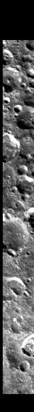
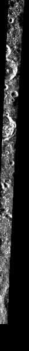

<!-- 本页由 `moondata pages` 生成，不要手改。已知问题改 docs/rois/known-issues.toml，其余数字改输入后重新生成。 -->

## 概况

| 项 | 值 |
|:---|:---|
| 所属划分 | 测试集（`Test`） |
| patch 对 | 372 |
| 带评测真值点的 patch | 286 / 372（76.9%） |
| 评测真值点对数 | 2,315 |
| 产物目录 | `Processed_Data/Test/ROI_007/` |
| 对齐控制点 | `data/tie-points/ROI_7/` |
| 元数据表中的写法 | `ROI_7` |

## Mini-RF 条带

| 项 | 值 | 来源 |
|:---|:---|:---|
| 产品 ID | `LSZ_05098_2CD_EKU_50N140_V1` | 官方 |
| 轨道号 | 5098 | 官方 |
| 任务阶段 | NOMINAL MISSION | 官方 |
| 成像时刻（UTC） | 2010-08-03T10:40:37 | 官方 |
| 模式 | ZOOM_S | 官方 |
| 中心频率 | 2.3800 GHz | 官方 |
| 入射角 | 50.66° | 官方 |
| 视向 | RIGHT | 官方 |
| 视方位角 | 92.54° | 官方 |
| 投影 | EQUIRECTANGULAR | 官方 |
| 地图分辨率 | 4096.0 像素/度 | 官方 |
| 原生采样间隔 | 7.4032 m | 官方 |
| 条带尺寸（宽 × 长） | 9,101 × 65,408 像素 | 官方 |
| 波段数 | 4 | 官方 |
| 有效分辨率（距离向） | 52.6 m | 实测 |
| 有效分辨率（方位向） | 19.0 m | 实测 |

「官方」取自该条带的 PDS 标签，「实测」是在本数据集影像上量出来的，口径见 `data/README.md`。

## 已知问题

::: {.callout-warning appearance="simple"}
## SAR 距离向有效分辨率异常偏粗

元数据表里距离向实测有效分辨率的中位数是 18.25 m；超过它的 2 倍（36.5 m）即标注于此。方位向没有这种现象。

旧参考文档 `DATA_REFERENCE.md` §1.6 记的是 ROI_7、ROI_24、ROI_42、ROI_67、ROI_80 五个（43–51 m），并称「全在 Train」。按本仓库的元数据表：ROI_27 也超过判定线，ROI_7 属测试集、ROI_80 属验证集。两处出入尚未核对。旧文档的记录还有一句：这几条的入射角、视向、模式、投影、ppd 与其余条带没有区别，也不是低对比度场景造成的——原因未查明。

**本 ROI：** 本 ROI 距离向 52.6 m，是中位数的 2.9 倍。

同一条还涉及：[ROI_024](ROI_024.md)、[ROI_027](ROI_027.md)、[ROI_042](ROI_042.md)、[ROI_067](ROI_067.md)、[ROI_080](ROI_080.md)。

出处：元数据表 `data/metadata/minirf_metadata.csv` 的「实测有效分辨率_距离向_m」列
:::

## 缩略图

::: {layout-ncol=2}

:::

取自对齐影像 `raw/ROI_7/cropped/ce2/opt.tif`、`raw/ROI_7/cropped/ce2/sar.tif`（5,570 × 66,654 像素），每 112 × 112 个像素取有效像素的均值并成一个，按行列原样画出；拉伸区间是有效像素的 2% 与 98% 分位。**黑色是没有数据的区域**，对齐影像按两者的外包框取景，所以 SAR 条带两侧常有大片黑边。

## 本页数字从哪来

- patch 数与评测真值点：统计快照 `stats/snapshot.json`，生成于 2026-09-23T07:25:37+08:00，数据指纹 `sha256:521b8fec4c1e1984cf4094fd7f709c51642a15b45b03bca34f569a39f5a038fb`。
- 条带参数：元数据表 `data/metadata/minirf_metadata.csv`。
- 缩略图：`moondata thumbnails` 生成于 2026-09-23T08:03:16+08:00。
- 已知问题：`docs/rois/known-issues.toml`（手写，每条注明出处）。
