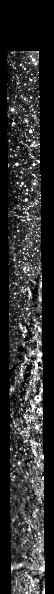

<!-- 本页由 `moondata pages` 生成，不要手改。已知问题改 docs/rois/known-issues.toml，其余数字改输入后重新生成。 -->

## 概况

| 项 | 值 |
|:---|:---|
| 所属划分 | 测试集（`Test`） |
| patch 对 | 159 |
| 带评测真值点的 patch | 141 / 159（88.7%） |
| 评测真值点对数 | 1,133 |
| 产物目录 | `Processed_Data/Test/ROI_037/` |
| 对齐控制点 | `data/tie-points/ROI_37/` |
| 元数据表中的写法 | `ROI_37` |

## Mini-RF 条带

| 项 | 值 | 来源 |
|:---|:---|:---|
| 产品 ID | `LSZ_01790_2CD_EKU_15S319_V1` | 官方 |
| 轨道号 | 1790 | 官方 |
| 任务阶段 | NOMINAL MISSION | 官方 |
| 成像时刻（UTC） | 2009-11-16T16:34:15 | 官方 |
| 模式 | ZOOM_S | 官方 |
| 中心频率 | 2.3800 GHz | 官方 |
| 入射角 | 53.04° | 官方 |
| 视向 | LEFT | 官方 |
| 视方位角 | 270.15° | 官方 |
| 投影 | EQUIRECTANGULAR | 官方 |
| 地图分辨率 | 4096.0 像素/度 | 官方 |
| 原生采样间隔 | 7.4032 m | 官方 |
| 条带尺寸（宽 × 长） | 2,632 × 66,155 像素 | 官方 |
| 波段数 | 4 | 官方 |
| 有效分辨率（距离向） | 18.2 m | 实测 |
| 有效分辨率（方位向） | 18.6 m | 实测 |

「官方」取自该条带的 PDS 标签，「实测」是在本数据集影像上量出来的，口径见 `data/README.md`。

## 已知问题

::: {.callout-warning appearance="simple"}
## 与 ROI_060 重复（ROI_060 已删除）

ROI_060 与本 ROI 是同一块地（同一条 Mini-RF 条带、同一幅 CE-2 分幅，152 个光学 patch 逐像素相同），2026-09-20 删除了 ROI_060、保留本 ROI。两边当年都做过评测真值点标注。

出处：删除清单；旧参考文档 `DATA_REFERENCE.md` §4
:::

## 缩略图

::: {layout-ncol=2}

:::

取自对齐影像 `raw/ROI_37/cropped/ce2/opt.tif`、`raw/ROI_37/cropped/ce2/sar.tif`（3,094 × 34,429 像素），每 58 × 58 个像素取有效像素的均值并成一个，按行列原样画出；拉伸区间是有效像素的 2% 与 98% 分位。**黑色是没有数据的区域**，对齐影像按两者的外包框取景，所以 SAR 条带两侧常有大片黑边。

## 本页数字从哪来

- patch 数与评测真值点：统计快照 `stats/snapshot.json`，生成于 2026-09-23T07:25:37+08:00，数据指纹 `sha256:521b8fec4c1e1984cf4094fd7f709c51642a15b45b03bca34f569a39f5a038fb`。
- 条带参数：元数据表 `data/metadata/minirf_metadata.csv`。
- 缩略图：`moondata thumbnails` 生成于 2026-09-23T08:03:16+08:00。
- 已知问题：`docs/rois/known-issues.toml`（手写，每条注明出处）。
