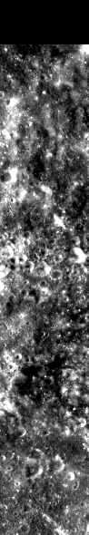
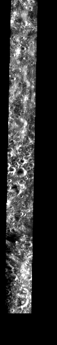

<!-- 本页由 `moondata pages` 生成，不要手改。已知问题改 docs/rois/known-issues.toml，其余数字改输入后重新生成。 -->

## 概况

| 项 | 值 |
|:---|:---|
| 所属划分 | 训练集（`Train`） |
| patch 对 | 170 |
| 带评测真值点的 patch | 无（训练集没有评测真值点） |
| 评测真值点对数 | — |
| 产物目录 | `Processed_Data/Train/ROI_052/` |
| 对齐控制点 | `data/tie-points/ROI_52/` |
| 元数据表中的写法 | `ROI_52` |

## Mini-RF 条带

| 项 | 值 | 来源 |
|:---|:---|:---|
| 产品 ID | `LSZ_02490_2CD_EKU_16N139_V1` | 官方 |
| 轨道号 | 2490 | 官方 |
| 任务阶段 | NOMINAL MISSION | 官方 |
| 成像时刻（UTC） | 2010-01-10T15:12:15 | 官方 |
| 模式 | ZOOM_S | 官方 |
| 中心频率 | 2.3800 GHz | 官方 |
| 入射角 | 48.80° | 官方 |
| 视向 | LEFT | 官方 |
| 视方位角 | 90.92° | 官方 |
| 投影 | EQUIRECTANGULAR | 官方 |
| 地图分辨率 | 4096.0 像素/度 | 官方 |
| 原生采样间隔 | 7.4032 m | 官方 |
| 条带尺寸（宽 × 长） | 4,066 × 65,753 像素 | 官方 |
| 波段数 | 4 | 官方 |
| 有效分辨率（距离向） | 18.0 m | 实测 |
| 有效分辨率（方位向） | 18.8 m | 实测 |

「官方」取自该条带的 PDS 标签，「实测」是在本数据集影像上量出来的，口径见 `data/README.md`。

## 已知问题

::: {.callout-warning appearance="simple"}
## 明显的局部错位

2026-09-11 的 patch 级配对检验（在每对 patch 上找光学与 SAR 的可信匹配、量两者的相对偏移，每个 ROI 按编号等间隔抽 24 对）把这几个 ROI 归为「明显错位」：patch 对的重叠面积中位数 66%~79%。偏移几乎都在 x 方向（横跨条带），y 方向基本为 0；错位程度与该 ROI 对齐控制点的拟合残差对得上。

这项检验只能当参考：它能证明一对 patch「是同一个地方」，证明不了「不是」。**待本人复核。**

**本 ROI：** 对齐控制点中位拟合残差 96 px。

同一条还涉及：[ROI_008](ROI_008.md)、[ROI_016](ROI_016.md)、[ROI_025](ROI_025.md)、[ROI_050](ROI_050.md)。

出处：2026-09-11 数据核查会话（配对检验）
:::

## 缩略图

::: {layout-ncol=2}

:::

取自对齐影像 `raw/ROI_52/cropped/ce2/opt.tif`、`raw/ROI_52/cropped/ce2/sar.tif`（4,780 × 28,874 像素），每 49 × 49 个像素取有效像素的均值并成一个，按行列原样画出；拉伸区间是有效像素的 2% 与 98% 分位。**黑色是没有数据的区域**，对齐影像按两者的外包框取景，所以 SAR 条带两侧常有大片黑边。

## 本页数字从哪来

- patch 数与评测真值点：统计快照 `stats/snapshot.json`，生成于 2026-09-23T07:25:37+08:00，数据指纹 `sha256:521b8fec4c1e1984cf4094fd7f709c51642a15b45b03bca34f569a39f5a038fb`。
- 条带参数：元数据表 `data/metadata/minirf_metadata.csv`。
- 缩略图：`moondata thumbnails` 生成于 2026-09-23T08:03:16+08:00。
- 已知问题：`docs/rois/known-issues.toml`（手写，每条注明出处）。
