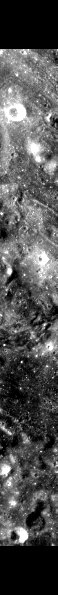
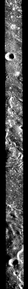

<!-- 本页由 `moondata pages` 生成，不要手改。已知问题改 docs/rois/known-issues.toml，其余数字改输入后重新生成。 -->

## 概况

| 项 | 值 |
|:---|:---|
| 所属划分 | 测试集（`Test`） |
| patch 对 | 168 |
| 带评测真值点的 patch | 145 / 168（86.3%） |
| 评测真值点对数 | 1,187 |
| 产物目录 | `Processed_Data/Test/ROI_054/` |
| 对齐控制点 | `data/tie-points/ROI_54/` |
| 元数据表中的写法 | `ROI_54` |

## Mini-RF 条带

| 项 | 值 | 来源 |
|:---|:---|:---|
| 产品 ID | `LSZ_01526_2CD_EKU_06S233_V1` | 官方 |
| 轨道号 | 1526 | 官方 |
| 任务阶段 | NOMINAL MISSION | 官方 |
| 成像时刻（UTC） | 2009-10-26T22:39:59 | 官方 |
| 模式 | ZOOM_S | 官方 |
| 中心频率 | 2.3800 GHz | 官方 |
| 入射角 | 47.55° | 官方 |
| 视向 | LEFT | 官方 |
| 视方位角 | 269.09° | 官方 |
| 投影 | EQUIRECTANGULAR | 官方 |
| 地图分辨率 | 4096.0 像素/度 | 官方 |
| 原生采样间隔 | 7.4032 m | 官方 |
| 条带尺寸（宽 × 长） | 2,765 × 52,703 像素 | 官方 |
| 波段数 | 4 | 官方 |
| 有效分辨率（距离向） | 18.3 m | 实测 |
| 有效分辨率（方位向） | 18.2 m | 实测 |

「官方」取自该条带的 PDS 标签，「实测」是在本数据集影像上量出来的，口径见 `data/README.md`。

## 已知问题

::: {.callout-warning appearance="simple"}
## 轻度的局部错位

2026-09-11 的 patch 级配对检验（每个 ROI 抽 24 对）把这几个 ROI 归为「轻度错位」：patch 对的重叠面积中位数 77%~95%，偏移几十像素，错开超过半个 patch 的样本在 10% 以下。同一检验的对照组（ROI_5、ROI_12、ROI_21）重叠面积为 97%~99%。

这项检验只能当参考（理由见「明显的局部错位」一条），**待本人复核。**

**本 ROI：** 测试集里唯一被归入此类的 ROI，重叠面积 86%。它的评测真值点标出的偏移是 dx 约 +17~90 px、dy 约 0，与检验结果方向一致。

同一条还涉及：[ROI_002](ROI_002.md)、[ROI_003](ROI_003.md)、[ROI_010](ROI_010.md)、[ROI_015](ROI_015.md)、[ROI_023](ROI_023.md)、[ROI_026](ROI_026.md)、[ROI_027](ROI_027.md)、[ROI_048](ROI_048.md)、[ROI_055](ROI_055.md)、[ROI_056](ROI_056.md)、[ROI_065](ROI_065.md)、[ROI_068](ROI_068.md)、[ROI_069](ROI_069.md)、[ROI_078](ROI_078.md)、[ROI_079](ROI_079.md)。

出处：2026-09-11 数据核查会话（配对检验）
:::

::: {.callout-warning appearance="simple"}
## Mini-RF 目录里有两个 SAR 文件

`raw/ROI_54/minirf/` 里有两个 SAR 文件，旧代码按文件名排序取第一个。产物与旧版一致，说明当年用的也是这个，只是没有明确规定用哪个。

出处：2026-09-11 数据核查会话
:::

::: {.callout-warning appearance="simple"}
## 与 ROI_017 的范围部分重叠

与训练集的 ROI_017 范围重叠 57%，但 patch 级只有 17 个 patch 有重叠、且都不超过 16%，当时判断可接受。

出处：旧参考文档 `DATA_REFERENCE.md` §4
:::

## 缩略图

::: {layout-ncol=2}

:::

取自对齐影像 `raw/ROI_54/cropped/ce2/opt.tif`、`raw/ROI_54/cropped/ce2/sar.tif`（3,251 × 33,915 像素），每 57 × 57 个像素取有效像素的均值并成一个，按行列原样画出；拉伸区间是有效像素的 2% 与 98% 分位。**黑色是没有数据的区域**，对齐影像按两者的外包框取景，所以 SAR 条带两侧常有大片黑边。

## 本页数字从哪来

- patch 数与评测真值点：统计快照 `stats/snapshot.json`，生成于 2026-09-23T07:25:37+08:00，数据指纹 `sha256:521b8fec4c1e1984cf4094fd7f709c51642a15b45b03bca34f569a39f5a038fb`。
- 条带参数：元数据表 `data/metadata/minirf_metadata.csv`。
- 缩略图：`moondata thumbnails` 生成于 2026-09-23T08:03:16+08:00。
- 已知问题：`docs/rois/known-issues.toml`（手写，每条注明出处）。
