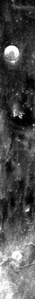
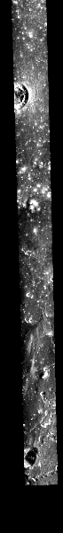

<!-- 本页由 `moondata pages` 生成，不要手改。已知问题改 docs/rois/known-issues.toml，其余数字改输入后重新生成。 -->

## 概况

| 项 | 值 |
|:---|:---|
| 所属划分 | 训练集（`Train`） |
| patch 对 | 119 |
| 带评测真值点的 patch | 无（训练集没有评测真值点） |
| 评测真值点对数 | — |
| 产物目录 | `Processed_Data/Train/ROI_073/` |
| 对齐控制点 | `data/tie-points/ROI_73/` |
| 元数据表中的写法 | `ROI_73` |

## Mini-RF 条带

| 项 | 值 | 来源 |
|:---|:---|:---|
| 产品 ID | `LSZ_01449_2CD_EKU_30N313_V1` | 官方 |
| 轨道号 | 1449 | 官方 |
| 任务阶段 | NOMINAL MISSION | 官方 |
| 成像时刻（UTC） | 2009-10-20T19:43:13 | 官方 |
| 模式 | ZOOM_S | 官方 |
| 中心频率 | 2.3800 GHz | 官方 |
| 入射角 | 52.96° | 官方 |
| 视向 | LEFT | 官方 |
| 视方位角 | 268.80° | 官方 |
| 投影 | EQUIRECTANGULAR | 官方 |
| 地图分辨率 | 4096.0 像素/度 | 官方 |
| 原生采样间隔 | 7.4032 m | 官方 |
| 条带尺寸（宽 × 长） | 2,949 × 33,579 像素 | 官方 |
| 波段数 | 4 | 官方 |
| 有效分辨率（距离向） | 17.8 m | 实测 |
| 有效分辨率（方位向） | 18.7 m | 实测 |

「官方」取自该条带的 PDS 标签，「实测」是在本数据集影像上量出来的，口径见 `data/README.md`。

## 已知问题

::: {.callout-warning appearance="simple"}
## 对齐控制点重标过，patch 重新编号

旧数据是双重错误：光学影像用了错误坐标（偏离约 205 km），而 `opt_tie.*` 实际标在 ROI_74 的影像上（存错了文件夹）。2026-09-11 在修正后的影像上重标了 30 对点（`data/tie-points/ROI_73/cropped_2/`），重切得到 119 对，原 98 对已删除，编号重新从零排起。

窗口清单 `data/windows/windows_train.json` 里本 ROI 的 98 个窗口是按旧的错误控制点算的，正向复现**不要求**与之一致。

出处：旧迁移记录 `MIGRATION.md`；`data/README.md`
:::

::: {.callout-warning appearance="simple"}
## CE-2 分幅的投影参数被改错，读取时纠正

本 ROI 所用的一幅 CE-2 分幅，随附投影文件的 `lat_ts` 抄成了相邻纬度带的值（E 带应为 35 却写成 21，I 带应为 −21 却写成 −35），像素和 geotransform 没动，整幅图因此被放到几度之外。旧代码在读取时按图幅名纠正，原文件不动；直接用通用 GIS 工具读原始瓦片会得到错误位置。

**本 ROI：** 出问题的分幅：E215。

同一条还涉及：[ROI_057](ROI_057.md)、[ROI_058](ROI_058.md)、[ROI_065](ROI_065.md)、[ROI_070](ROI_070.md)。

出处：旧迁移记录 `MIGRATION.md`；旧参考文档 `DATA_REFERENCE.md` §2
:::

## 缩略图

::: {layout-ncol=2}

:::

取自对齐影像 `raw/ROI_73/cropped/ce2/opt.tif`、`raw/ROI_73/cropped/ce2/sar.tif`（3,261 × 27,249 像素），每 46 × 46 个像素取有效像素的均值并成一个，按行列原样画出；拉伸区间是有效像素的 2% 与 98% 分位。**黑色是没有数据的区域**，对齐影像按两者的外包框取景，所以 SAR 条带两侧常有大片黑边。

## 本页数字从哪来

- patch 数与评测真值点：统计快照 `stats/snapshot.json`，生成于 2026-09-23T07:25:37+08:00，数据指纹 `sha256:521b8fec4c1e1984cf4094fd7f709c51642a15b45b03bca34f569a39f5a038fb`。
- 条带参数：元数据表 `data/metadata/minirf_metadata.csv`。
- 缩略图：`moondata thumbnails` 生成于 2026-09-23T08:03:16+08:00。
- 已知问题：`docs/rois/known-issues.toml`（手写，每条注明出处）。
