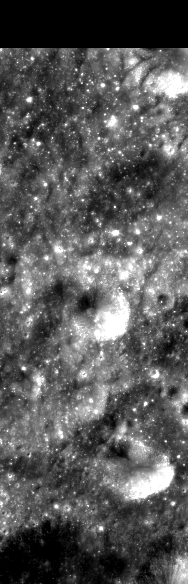
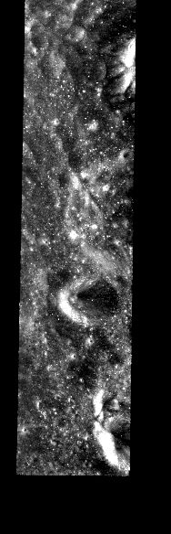

# ROI_001

训练集 · Mini-RF LSZ_02319_2CD_EKU_23S131_V1

## 概况

| 项 | 值 |
|:---|:---|
| 所属划分 | 训练集（`Train`） |
| patch 对 | 40 |
| 带评测真值点的 patch | 无（训练集没有评测真值点） |
| 评测真值点对数 | — |
| 产物目录 | `Processed_Data/Train/ROI_001/` |
| 对齐控制点 | `data/tie-points/ROI_1/` |
| 元数据表中的写法 | `ROI_1` |

## Mini-RF 条带

| 项 | 值 | 来源 |
|:---|:---|:---|
| 产品 ID | `LSZ_02319_2CD_EKU_23S131_V1` | 官方 |
| 轨道号 | 2319 | 官方 |
| 任务阶段 | NOMINAL MISSION | 官方 |
| 成像时刻（UTC） | 2009-12-28T05:47:26 | 官方 |
| 模式 | ZOOM_S | 官方 |
| 中心频率 | 2.3800 GHz | 官方 |
| 入射角 | 49.75° | 官方 |
| 视向 | LEFT | 官方 |
| 视方位角 | 271.10° | 官方 |
| 投影 | EQUIRECTANGULAR | 官方 |
| 地图分辨率 | 4096.0 像素/度 | 官方 |
| 原生采样间隔 | 7.4032 m | 官方 |
| 条带尺寸（宽 × 长） | 3,287 × 55,819 像素 | 官方 |
| 波段数 | 4 | 官方 |
| 有效分辨率（距离向） | 18.6 m | 实测 |
| 有效分辨率（方位向） | 18.4 m | 实测 |

## 缩略图

取自对齐影像 `raw/ROI_1/cropped/ce2/opt.tif`、`raw/ROI_1/cropped/ce2/sar.tif`（3,189 × 9,928 像素），每 17 × 17 个像素取有效像素的均值并成一个，按行列原样画出；拉伸区间是有效像素的 2% 与 98% 分位。**黑色是没有数据的区域**，对齐影像按两者的外包框取景，所以 SAR 条带两侧常有大片黑边。

