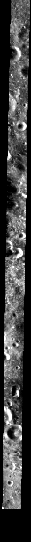

# ROI_008

训练集 · Mini-RF LSZ_03124_2CD_EKU_07N202_V1

## 概况

| 项 | 值 |
|:---|:---|
| 所属划分 | 训练集（`Train`） |
| patch 对 | 291 |
| 带评测真值点的 patch | 无（训练集没有评测真值点） |
| 评测真值点对数 | — |
| 产物目录 | `Processed_Data/Train/ROI_008/` |
| 对齐控制点 | `data/tie-points/ROI_8/` |
| 元数据表中的写法 | `ROI_8` |

## Mini-RF 条带

| 项 | 值 | 来源 |
|:---|:---|:---|
| 产品 ID | `LSZ_03124_2CD_EKU_07N202_V1` | 官方 |
| 轨道号 | 3124 | 官方 |
| 任务阶段 | NOMINAL MISSION | 官方 |
| 成像时刻（UTC） | 2010-03-01T10:21:14 | 官方 |
| 模式 | ZOOM_S | 官方 |
| 中心频率 | 2.3800 GHz | 官方 |
| 入射角 | 46.44° | 官方 |
| 视向 | LEFT | 官方 |
| 视方位角 | 90.48° | 官方 |
| 投影 | EQUIRECTANGULAR | 官方 |
| 地图分辨率 | 4096.0 像素/度 | 官方 |
| 原生采样间隔 | 7.4032 m | 官方 |
| 条带尺寸（宽 × 长） | 3,635 × 65,327 像素 | 官方 |
| 波段数 | 4 | 官方 |
| 有效分辨率（距离向） | 18.9 m | 实测 |
| 有效分辨率（方位向） | 18.9 m | 实测 |

## 已知问题

### 明显的局部错位

2026-09-11 的 patch 级配对检验（在每对 patch 上找光学与 SAR 的可信匹配、量两者的相对偏移，每个 ROI 按编号等间隔抽 24 对）把这几个 ROI 归为「明显错位」：patch 对的重叠面积中位数 66%~79%。偏移几乎都在 x 方向（横跨条带），y 方向基本为 0；错位程度与该 ROI 对齐控制点的拟合残差对得上。

这项检验只能当参考：它能证明一对 patch「是同一个地方」，证明不了「不是」。

**本 ROI：** 可信匹配里有 33% 的 patch 对错开超过半个 patch；对齐控制点中位拟合残差 161 px。

同一条还涉及：[ROI_016](ROI_016.md)、[ROI_025](ROI_025.md)、[ROI_050](ROI_050.md)、[ROI_052](ROI_052.md)。

出处：2026-09-11 数据核查会话（配对检验）

## 缩略图

取自对齐影像 `raw/ROI_8/cropped/ce2/opt.tif`、`raw/ROI_8/cropped/ce2/sar.tif`（3,895 × 68,290 像素），每 114 × 114 个像素取有效像素的均值并成一个，按行列原样画出；拉伸区间是有效像素的 2% 与 98% 分位。**黑色是没有数据的区域**，对齐影像按两者的外包框取景，所以 SAR 条带两侧常有大片黑边。

