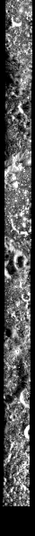

# ROI_009

训练集 · Mini-RF LSZ_02041_2CD_EKU_04N061_V1

## 概况

| 项 | 值 |
|:---|:---|
| 所属划分 | 训练集（`Train`） |
| patch 对 | 162 |
| 带评测真值点的 patch | 无（训练集没有评测真值点） |
| 评测真值点对数 | — |
| 产物目录 | `Processed_Data/Train/ROI_009/` |
| 对齐控制点 | `data/tie-points/ROI_9/` |
| 元数据表中的写法 | `ROI_9` |

## Mini-RF 条带

| 项 | 值 | 来源 |
|:---|:---|:---|
| 产品 ID | `LSZ_02041_2CD_EKU_04N061_V1` | 官方 |
| 轨道号 | 2041 | 官方 |
| 任务阶段 | NOMINAL MISSION | 官方 |
| 成像时刻（UTC） | 2009-12-06T08:00:54 | 官方 |
| 模式 | ZOOM_S | 官方 |
| 中心频率 | 2.3800 GHz | 官方 |
| 入射角 | 52.47° | 官方 |
| 视向 | LEFT | 官方 |
| 视方位角 | 271.01° | 官方 |
| 投影 | EQUIRECTANGULAR | 官方 |
| 地图分辨率 | 4096.0 像素/度 | 官方 |
| 原生采样间隔 | 7.4032 m | 官方 |
| 条带尺寸（宽 × 长） | 1,881 × 33,525 像素 | 官方 |
| 波段数 | 4 | 官方 |
| 有效分辨率（距离向） | 18.3 m | 实测 |
| 有效分辨率（方位向） | 18.6 m | 实测 |

## 已知问题

### 局部错位，错开的距离随位置变化

2026-09-11 的配对检验抽样时几乎找不到可信匹配，随后把 162 对全部跑了一遍：29 对（18%）找到了可信匹配（对照组 ROI_12 为 70%）。纹理指数与对照组相近（光学 3.39 / 2.52 对 3.62 / 2.58），排除了纹理平淡。找到匹配的 patch 显示并没有配错片，但 SAR 相对光学的横向偏移**分段变化**：

| 光学窗口所在行 | 偏移 dx（像素） |
|---|---|
| 3072 ~ 5632 | 一对都没找到 |
| 6144 ~ 8704 | +88 ~ +128 |
| 9216 ~ 14848 | −96 ~ −108 |
| 15360 ~ 17920 | −188 ~ −216 |
| 18432 ~ 24064 | −64 ~ +36 |

对齐控制点的拟合残差中位 73 px、最大 227 px。原因未查明，

出处：2026-09-11 数据核查会话（配对检验，全量）

## 缩略图

取自对齐影像 `raw/ROI_9/cropped/ce2/opt.tif`、`raw/ROI_9/cropped/ce2/sar.tif`（2,211 × 33,916 像素），每 57 × 57 个像素取有效像素的均值并成一个，按行列原样画出；拉伸区间是有效像素的 2% 与 98% 分位。**黑色是没有数据的区域**，对齐影像按两者的外包框取景，所以 SAR 条带两侧常有大片黑边。

