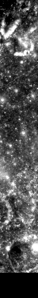
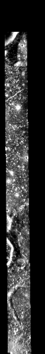

# ROI_011

测试集 · Mini-RF LSZ_02689_2CD_EKU_16S293_V1

## 概况

| 项 | 值 |
|:---|:---|
| 所属划分 | 测试集（`Test`） |
| patch 对 | 92 |
| 带评测真值点的 patch | 83 / 92（90.2%） |
| 评测真值点对数 | 706 |
| 产物目录 | `Processed_Data/Test/ROI_011/` |
| 对齐控制点 | `data/tie-points/ROI_11/` |
| 元数据表中的写法 | `ROI_11` |

## Mini-RF 条带

| 项 | 值 | 来源 |
|:---|:---|:---|
| 产品 ID | `LSZ_02689_2CD_EKU_16S293_V1` | 官方 |
| 轨道号 | 2689 | 官方 |
| 任务阶段 | NOMINAL MISSION | 官方 |
| 成像时刻（UTC） | 2010-01-26T06:29:37 | 官方 |
| 模式 | ZOOM_S | 官方 |
| 中心频率 | 2.3800 GHz | 官方 |
| 入射角 | 51.41° | 官方 |
| 视向 | LEFT | 官方 |
| 视方位角 | 89.29° | 官方 |
| 投影 | EQUIRECTANGULAR | 官方 |
| 地图分辨率 | 4096.0 像素/度 | 官方 |
| 原生采样间隔 | 7.4032 m | 官方 |
| 条带尺寸（宽 × 长） | 3,199 × 66,241 像素 | 官方 |
| 波段数 | 4 | 官方 |
| 有效分辨率（距离向） | 18.4 m | 实测 |
| 有效分辨率（方位向） | 18.7 m | 实测 |

## 已知问题

### 目录里有别处遗留的控制点文件

`opt_tie.txt` / `opt_tie.prj`（也随仓库入库在 `data/tie-points/ROI_11/cropped/`）是别处遗留的文件，流程没用到，但容易让人误以为与本 ROI 的 `opt_tie.pts` 是同一批点。

出处：2026-09-11 数据核查会话

## 缩略图

取自对齐影像 `raw/ROI_11/cropped/ce2/opt.tif`、`raw/ROI_11/cropped/ce2/sar.tif`（3,761 × 29,483 像素），每 50 × 50 个像素取有效像素的均值并成一个，按行列原样画出；拉伸区间是有效像素的 2% 与 98% 分位。**黑色是没有数据的区域**，对齐影像按两者的外包框取景，所以 SAR 条带两侧常有大片黑边。

