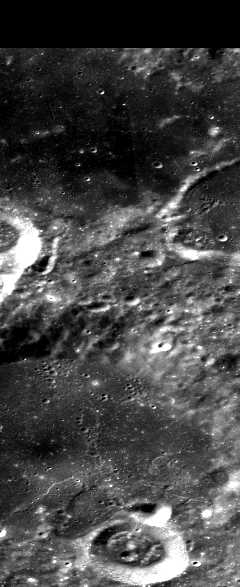
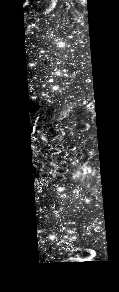

# ROI_034

训练集 · Mini-RF LSZ_02457_2CD_EKU_49S174_V1

## 概况

| 项 | 值 |
|:---|:---|
| 所属划分 | 训练集（`Train`） |
| patch 对 | 199 |
| 带评测真值点的 patch | 无（训练集没有评测真值点） |
| 评测真值点对数 | — |
| 产物目录 | `Processed_Data/Train/ROI_034/` |
| 对齐控制点 | `data/tie-points/ROI_34/` |
| 元数据表中的写法 | `ROI_34` |

## Mini-RF 条带

| 项 | 值 | 来源 |
|:---|:---|:---|
| 产品 ID | `LSZ_02457_2CD_EKU_49S174_V1` | 官方 |
| 轨道号 | 2457 | 官方 |
| 任务阶段 | NOMINAL MISSION | 官方 |
| 成像时刻（UTC） | 2010-01-08T01:22:33 | 官方 |
| 模式 | ZOOM_S | 官方 |
| 中心频率 | 2.3800 GHz | 官方 |
| 入射角 | 53.72° | 官方 |
| 视向 | LEFT | 官方 |
| 视方位角 | 87.52° | 官方 |
| 投影 | EQUIRECTANGULAR | 官方 |
| 地图分辨率 | 4096.0 像素/度 | 官方 |
| 原生采样间隔 | 7.4032 m | 官方 |
| 条带尺寸（宽 × 长） | 6,071 × 32,998 像素 | 官方 |
| 波段数 | 4 | 官方 |
| 有效分辨率（距离向） | 16.8 m | 实测 |
| 有效分辨率（方位向） | 18.3 m | 实测 |

## 已知问题

### 一幅 CE-2 分幅的经度差了 180°

该分幅的名字写的是东经 175°，按坐标算出来是西经 5°。现有产物与旧版逐像素一致；只有将来从原始数据重新对齐时才会碰到。

出处：2026-09-11 数据核查会话

## 缩略图

取自对齐影像 `raw/ROI_34/cropped/ce2/opt.tif`、`raw/ROI_34/cropped/ce2/sar.tif`（7,191 × 17,599 像素），每 30 × 30 个像素取有效像素的均值并成一个，按行列原样画出；拉伸区间是有效像素的 2% 与 98% 分位。**黑色是没有数据的区域**，对齐影像按两者的外包框取景，所以 SAR 条带两侧常有大片黑边。

