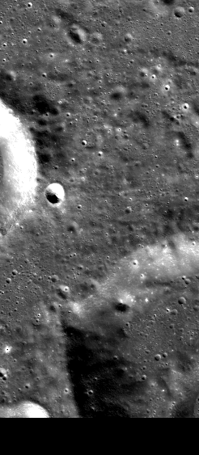
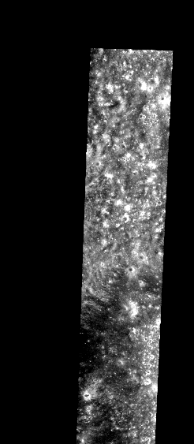

# ROI_042

训练集 · Mini-RF LSZ_05032_2CD_EKU_50N208_V1

## 概况

| 项 | 值 |
|:---|:---|
| 所属划分 | 训练集（`Train`） |
| patch 对 | 21 |
| 带评测真值点的 patch | 无（训练集没有评测真值点） |
| 评测真值点对数 | — |
| 产物目录 | `Processed_Data/Train/ROI_042/` |
| 对齐控制点 | `data/tie-points/ROI_42/` |
| 元数据表中的写法 | `ROI_42` |

## Mini-RF 条带

| 项 | 值 | 来源 |
|:---|:---|:---|
| 产品 ID | `LSZ_05032_2CD_EKU_50N208_V1` | 官方 |
| 轨道号 | 5032 | 官方 |
| 任务阶段 | NOMINAL MISSION | 官方 |
| 成像时刻（UTC） | 2010-07-29T06:17:26 | 官方 |
| 模式 | ZOOM_S | 官方 |
| 中心频率 | 2.3800 GHz | 官方 |
| 入射角 | 48.20° | 官方 |
| 视向 | RIGHT | 官方 |
| 视方位角 | 91.55° | 官方 |
| 投影 | EQUIRECTANGULAR | 官方 |
| 地图分辨率 | 4096.0 像素/度 | 官方 |
| 原生采样间隔 | 7.4032 m | 官方 |
| 条带尺寸（宽 × 长） | 6,395 × 66,220 像素 | 官方 |
| 波段数 | 4 | 官方 |
| 有效分辨率（距离向） | 50.5 m | 实测 |
| 有效分辨率（方位向） | 19.0 m | 实测 |

## 缩略图

取自对齐影像 `raw/ROI_42/cropped/ce2/opt.tif`、`raw/ROI_42/cropped/ce2/sar.tif`（3,439 × 7,872 像素），每 14 × 14 个像素取有效像素的均值并成一个，按行列原样画出；拉伸区间是有效像素的 2% 与 98% 分位。**黑色是没有数据的区域**，对齐影像按两者的外包框取景，所以 SAR 条带两侧常有大片黑边。

