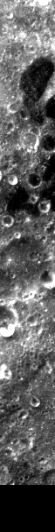
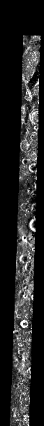

# ROI_065

训练集 · Mini-RF LSZ_02346_2CD_EKU_32S103_V1

## 概况

| 项 | 值 |
|:---|:---|
| 所属划分 | 训练集（`Train`） |
| patch 对 | 172 |
| 带评测真值点的 patch | 无（训练集没有评测真值点） |
| 评测真值点对数 | — |
| 产物目录 | `Processed_Data/Train/ROI_065/` |
| 对齐控制点 | `data/tie-points/ROI_65/` |
| 元数据表中的写法 | `ROI_65` |

## Mini-RF 条带

| 项 | 值 | 来源 |
|:---|:---|:---|
| 产品 ID | `LSZ_02346_2CD_EKU_32S103_V1` | 官方 |
| 轨道号 | 2346 | 官方 |
| 任务阶段 | NOMINAL MISSION | 官方 |
| 成像时刻（UTC） | 2009-12-30T08:38:13 | 官方 |
| 模式 | ZOOM_S | 官方 |
| 中心频率 | 2.3800 GHz | 官方 |
| 入射角 | 53.02° | 官方 |
| 视向 | LEFT | 官方 |
| 视方位角 | 271.81° | 官方 |
| 投影 | EQUIRECTANGULAR | 官方 |
| 地图分辨率 | 4096.0 像素/度 | 官方 |
| 原生采样间隔 | 7.4032 m | 官方 |
| 条带尺寸（宽 × 长） | 5,431 × 65,654 像素 | 官方 |
| 波段数 | 4 | 官方 |
| 有效分辨率（距离向） | 18.4 m | 实测 |
| 有效分辨率（方位向） | 19.0 m | 实测 |

## 已知问题

### 轻度的局部错位

2026-09-11 的 patch 级配对检验（每个 ROI 抽 24 对）把这几个 ROI 归为「轻度错位」：patch 对的重叠面积中位数 77%~95%，偏移几十像素，错开超过半个 patch 的样本在 10% 以下。同一检验的对照组（ROI_5、ROI_12、ROI_21）重叠面积为 97%~99%。

这项检验只能当参考（理由见「明显的局部错位」一条），

同一条还涉及：[ROI_002](ROI_002.md)、[ROI_003](ROI_003.md)、[ROI_010](ROI_010.md)、[ROI_015](ROI_015.md)、[ROI_023](ROI_023.md)、[ROI_026](ROI_026.md)、[ROI_027](ROI_027.md)、[ROI_048](ROI_048.md)、[ROI_054](ROI_054.md)、[ROI_055](ROI_055.md)、[ROI_056](ROI_056.md)、[ROI_068](ROI_068.md)、[ROI_069](ROI_069.md)、[ROI_078](ROI_078.md)、[ROI_079](ROI_079.md)。

出处：2026-09-11 数据核查会话（配对检验）

### CE-2 分幅的投影参数被改错，读取时纠正

本 ROI 所用的一幅 CE-2 分幅，随附投影文件的 `lat_ts` 抄成了相邻纬度带的值（E 带应为 35 却写成 21，I 带应为 −21 却写成 −35），像素和 geotransform 没动，整幅图因此被放到几度之外。旧代码在读取时按图幅名纠正，原文件不动；直接用通用 GIS 工具读原始瓦片会得到错误位置。

**本 ROI：** 出问题的分幅：I236。

同一条还涉及：[ROI_057](ROI_057.md)、[ROI_058](ROI_058.md)、[ROI_070](ROI_070.md)、[ROI_073](ROI_073.md)。

出处：旧迁移记录 `MIGRATION.md`；旧参考文档 `DATA_REFERENCE.md` §2

## 缩略图

取自对齐影像 `raw/ROI_65/cropped/ce2/opt.tif`、`raw/ROI_65/cropped/ce2/sar.tif`（5,270 × 50,254 像素），每 84 × 84 个像素取有效像素的均值并成一个，按行列原样画出；拉伸区间是有效像素的 2% 与 98% 分位。**黑色是没有数据的区域**，对齐影像按两者的外包框取景，所以 SAR 条带两侧常有大片黑边。

